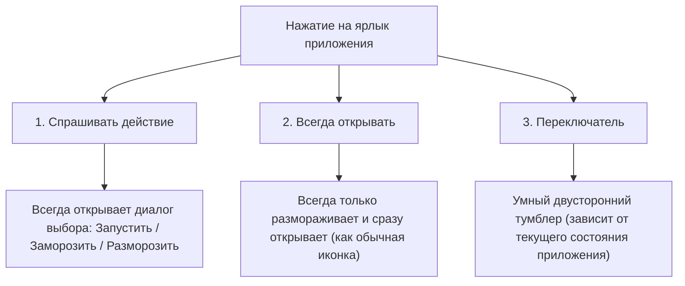

# Руководство по логике и режимам ярлыков FreezeYou

> **Расположение в приложении:**  
> **«Настройки»** $\rightarrow$ **«Заморозка и разморозка»** $\rightarrow$ карточка **«Ярлыки»** $\rightarrow$ **«Действие при нажатии на ярлык приложения»**.

Документ подробно описывает логику работы ярлыков приложений на рабочем столе Android, замысел создателя утилиты и поведение каждого переключателя.

---

## 1. Три основных режима работы ярлыка

В выпадающем списке настройки доступны 3 взаимоисключающих режима:



1. **«Спрашивать действие (по умолчанию)» (`dialog`):**  
   Ручной режим. При любом нажатии показывает системный диалог с кнопками действий. Никаких автоматических изменений состояния без ведома пользователя.
2. **«Всегда открывать (разморозка и запуск)» (`open_and_uf`):**  
   Поведение стандартного ярлыка рабочего стола Android. Если приложение заморожено — тихо размораживает и сразу запускает. Если уже разморожено — просто открывает. Заморозить приложение через этот ярлык нельзя.
3. **«Переключатель (заморозка / разморозка)» (`toggle`):**  
   Двусторонний тумблер. Если приложение заморожено — размораживает. Если разморожено — замораживает.

---

## 2. Сводная матрица поведения

| Выбранный режим | Нажатие на ярлык, когда приложение ЗАМОРОЖЕНО | Нажатие на ярлык, когда приложение РАЗМОРОЖЕНО |
| :--- | :--- | :--- |
| **1. Спрашивать действие** | Диалог: «Выберите подробное действие» $\rightarrow$ **[Разморозить]** / **[Отмена]** | Диалог: «Выберите подробное действие» $\rightarrow$ **[Запустить]** / **[Заморозить]** / **[Отмена]** |
| **2. Всегда открывать** | Мгновенная разморозка и **запуск приложения на экран** (без диалогов) | Просто **запуск приложения на экран** (без диалогов) |
| **3. Переключатель** *(по умолчанию: чекбокс 1 ВКЛ, 2 ВЫКЛ)* | Мгновенная разморозка и **запуск приложения на экран** (без диалогов) | Мгновенная **заморозка приложения** (без диалогов) |
| **3. Переключатель** *(со страховкой: оба чекбокса ВКЛ)* | Мгновенная разморозка и **запуск приложения на экран** (без диалогов) | Диалог подтверждения: **«Заморозить? [Да / Нет]»** |
| **3. Переключатель** *(оба чекбокса ВЫКЛ)* | Разморозка в фоне + вопрос: **«Запрошена разморозка, попробовать сразу запустить? [Да / Нет]»** | Мгновенная **заморозка приложения** (без диалогов) |

---

## 3. Разгадка «ребуса»: режим «Переключатель» и 2 его чекбокса

При выборе режима **«Переключатель (заморозка / разморозка)»** под ним раскрываются две тонкие настройки:
1. `openImmediatelyAfterUnfreezeUseShortcutAutoFUF` — **«Запускать приложение сразу после разморозки»** (по умолчанию: *ВКЛ*).
2. `needConfirmWhenFreezeUseShortcutAutoFUF` — **«Дополнительное подтверждение при заморозке»** (по умолчанию: *ВЫКЛ*).

### Замысел создателя утилиты (Playhi)
Человек, создававший FreezeYou, решал проблему **асимметрии цены ошибки**:
* **Разморозить приложение случайно** — безобидно (оно просто станет доступно в системе).
* **Случайно заморозить работающее приложение** касанием пальца по рабочему столу — деструктивно (мгновенно убивается процесс, могут сброситься несохраненные данные, прерываются загрузки и синк).

Поэтому автор разделил поведение на вход и на выход:
* **На вход (разморозка):** нулевое трение — нажал и сразу пользуешься (`openImmediatelyAfterUnfreezeUseShortcutAutoFUF`).
* **На выход (заморозка):** страховка от случайного мисклика — переспросить перед тем, как убить приложение (`needConfirmWhenFreezeUseShortcutAutoFUF`).

---

## 4. Главный вопрос: Становится ли «Переключатель» клоном «Спрашивать действие», если включить оба чекбокса?

**НЕТ, не становится!**  
Они работают принципиально по-разному в момент запуска:

* В **Режиме 1 («Спрашивать действие»)** вы **никогда не можете открыть замороженное приложение в один клик** — каждый раз вылезает диалог, требующий нажать «Разморозить». Это режим с высоким трением в обе стороны.
* В **Режиме 3 («Переключатель» с 2 включенными чекбоксами)** вы открываете замороженное приложение **мгновенно в 1 тап** (как обычную иконку), но получаете **страховку от случайного закрытия** (при тапе по активному приложению система переспросит, действительно ли вы хотите его заморозить).

### Когда же «Переключатель» превращается в подобие Режима 1?
Только в одной странной комбинации:
* Чекбокс *«Запускать сразу после разморозки»* **ВЫКЛЮЧЕН**, а чекбокс *«Подтверждение при заморозке»* **ВКЛЮЧЕН**.
* В этом случае диалоги будут всплывать и при разморозке («Запустить? Да/Нет»), и при заморозке («Заморозить? Да/Нет»). Этой комбинацией в реальной жизни практически никто не пользуется.

---

## 5. Шпаргалка: что выбрать под свои задачи

1. **«Хочу ярлык как обычную иконку Android (только разморозить и запустить):»**  
   $\rightarrow$ Выбирайте режим **«Всегда открывать (разморозка и запуск)»**.  
   *(Замораживать будете через шторку Quick Settings, виджет или список FreezeYou).*

2. **«Хочу чистый тумблер в 1 клик в обе стороны (нажал — открыл, нажал — закрыл):»**  
   $\rightarrow$ Выбирайте режим **«Переключатель (заморозка / разморозка)»** с настройками по умолчанию:  
   * [x] Запускать приложение сразу после разморозки  
   * [ ] Дополнительное подтверждение при заморозке

3. **«Хочу тумблер, но боюсь случайно закрыть приложение мискликом по экрану:»**  
   $\rightarrow$ Выбирайте режим **«Переключатель (заморозка / разморозка)»** со страховкой:  
   * [x] Запускать приложение сразу после разморозки  
   * [x] Дополнительное подтверждение при заморозке

4. **«Хочу всегда вручную выбирать, что делать при каждом нажатии:»**  
   $\rightarrow$ Выбирайте режим **«Спрашивать действие (по умолчанию)»**.

---

## 6. Резервное копирование и восстановление ярлыков

В Батче 63 в форк была добавлена возможность сохранения и восстановления ярлыков рабочего стола через файлы резервных копий (`.fybak`).

### 6.1. Архитектура и принцип работы
1. **Реестр ярлыков в MMKV (`KEY_SAVED_SHORTCUTS` = `launcher_saved_shortcuts`):**  
   При создании любого ярлыка FreezeYou сохраняет метаданные (`id`, `name`, `pkgName`, `cls`, `target`, `tasks`, `justLaunch`) во внутреннее хранилище.
2. **Экспорт и импорт:**  
   Секция `"launcherShortcuts"` сериализуется в JSON-файл бэкапа. При восстановлении бэкапа проверяется количество сохраненных ярлыков. Если в бэкапе 0 ярлыков, категория скрывается из окна выбора.
3. **Безопасность (белый список классов):**  
   При импорте из файла и отправке запроса на закрепление ярлыка разрешены только 7 доверенных классов FreezeYou (`Freeze`, `ForceStop`, `OneKeyFreeze`, `OneKeyUF`, `ui.OneKeyScreenLockImmediatelyActivity`, `OneKeyScreenLockImmediatelyActivity`, `Main`).
4. **Очередь пошагового восстановления (`RestoreShortcutsActivity`):**  
   Пользователю последовательно предлагаются ярлыки через компактную панель действий с кнопками «Отмена», «Пропуск» и «ОК».

### 6.2. История изменений по коммитам
* `e3e5240d` — базовая реализация экспорта, импорта и активности очереди восстановления.
* `b9ac0d2b` — ужесточение проверок (T1–T5: фильтрация уже закрепленных ярлыков, обработка сбоев, белый список классов, сохранение состояния).
* `be938148` — удаление отдельной лишней кнопки восстановления с главного экрана бэкапа (восстановление перенесено строго в единый мастер выбора категорий).
* `1f51ab92` — выравнивание высоты кнопок по одной линии, предотвращение переноса слов и сокращение заголовка до «Восстановление ярлыков».
* `cadcb890` — скрытие категорий с 0 элементов в диалоге выбора бэкапа (VF-06), удаление неиспользуемого кода старой очистки `cleanUninstalledShortcuts` (VF-03) и изоляция фильтра белого списка на границе внешнего файла бэкапа (VF-02).

### 6.3. Инструкция по откату (Rollback)
В случае необходимости отката:
* **Полный откат всей функции ярлыков (до состояния до Батча 63):**
  ```bash
  git revert --no-edit cadcb890 1f51ab92 be938148 b9ac0d2b e3e5240d
  ```
* **Откат только последних доработок (коммита `cadcb890`):**
  ```bash
  git revert --no-edit cadcb890
  ```
